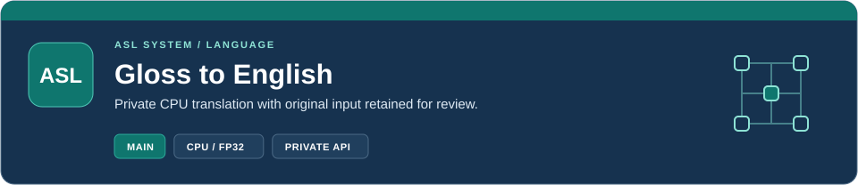
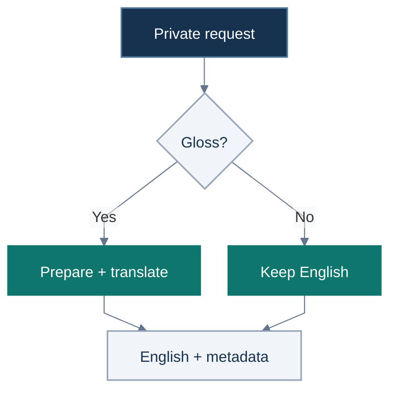

# ASL Gloss Translator



Private CPU translation for ASL-Web. The service converts detected ASL glosses
into English before the hotel backend stores and broadcasts a guest request.
Natural English is detected and passed through unchanged.

The service runs the original domain-tuned FLAN-T5 package: FP32 ONNX encoder and
decoder, tokenizer, context correction, preprocessing, and noun checks. Package
weights and scripts remain unchanged. The container needs no GPU, PyTorch, or
Transformers and downloads no model at runtime.

[Setup](#local-startup) · [Translation flow](#translation-flow) · [API](#private-api) · [Limits](#limits-and-failure-behavior) · [Testing](#verification)

## Translation flow

Automatic detection preserves natural English and translates detected glosses through the verified package.



## Model package and resources

Supply the verified package separately at
`model_onnx/asl_translator_fp32/asl_translator_fp32` under the ASL-System root.
The build and startup verify sizes and SHA-256 hashes for all 16 manifest files.
Loading happens once per process; health is available after loading completes.

The two FP32 ONNX files total 1,089,917,491 bytes, approximately 1.02 GiB. Runtime
memory exceeds weight size. Allow at least 3 GiB of free memory for local tests
and measure representative traffic with `docker stats` before setting production
limits. Each additional worker would load another model copy.

Model packages are ignored by Git. Distribute verified weights or a built image
through a private channel; cloning this repository alone does not supply them.

## Private API

`POST /translate` accepts:

```json
{
  "text": "I WATER NEED",
  "source": "recognizer",
  "is_question": false
}
```

`text` is required. `source` accepts `"recognizer"` or `null`; omit it for automatic
gloss/English detection. `is_question` accepts a boolean or `null` and is optional.

Illustrative response:

```json
{
  "gloss": "I WATER NEED",
  "input_type": "gloss",
  "corrected": "I WATER NEED",
  "changes": [],
  "preprocessed": "X-I NEED WATER",
  "english": "I need water.",
  "noun_fixes": []
}
```

Exact text depends on the model. `GET /health` returns:

```json
{"status":"ok","model":"asl_gloss_to_english","variant":"fp32"}
```

The service does not authenticate hotel users. Keep it accessible only to the
backend over a private Docker network or a loopback-bound development port.
It has no public gateway route and is not called directly by guest/staff apps.
ASL-Web retains guest authentication and authorization.

## Limits and failure behavior

| Constraint | Behavior |
| --- | --- |
| JSON body | Maximum 8192 bytes; oversized bodies return `413` |
| Text | 1–2000 characters; blank/invalid input returns `422` |
| Effective model input | Maximum 128 tokens including preprocessing and prefix; excess returns `422` |
| Generation | Four beams, maximum 128 output tokens |
| Concurrency | One inference; no request queue |
| Busy response | `503 translator_busy`, `Retry-After: 1` |
| HTTP deadline | Default 10 seconds; timeout returns `504` |
| Model unavailable / inference failure | `503` |

Input is rejected rather than silently truncated. Error responses omit received
text. A timed-out HTTP wait does not cancel native ONNX work: the inference slot
remains occupied until execution finishes. Retain the original gloss for review;
translations may contain errors or omissions.

## Local startup

From the ASL-System root:

```powershell
docker compose -f docker-compose.gloss.yml up -d --build --wait --wait-timeout 180
Invoke-RestMethod http://127.0.0.1:8002/health
```

For ASL-Web running on the host, set
`GLOSS_TRANSLATOR_URL=http://127.0.0.1:8002` and restart the backend. On the same
Docker network, use `http://asl-gloss-translator:8000`. The Web server Compose file
already includes that private service connection.

An independent build also uses the repository root as its context:

```powershell
docker build -f ASL-GlossTranslator/Dockerfile -t asl-gloss-translator .
docker run --rm -p 127.0.0.1:8002:8000 asl-gloss-translator
```

The [Docker build allowlist](Dockerfile.dockerignore) excludes other application
dependencies, local environments, and logs. The container runs without root
privileges. Stop only the local translator with:

```powershell
docker compose -f docker-compose.gloss.yml stop asl-gloss-translator
```

| Environment variable | Default | Purpose |
| --- | --- | --- |
| `TRANSLATOR_THREADS` | `2` | ONNX CPU threads per session, 1–16 |
| `TRANSLATOR_TIMEOUT_SECONDS` | `10` | HTTP deadline, greater than 0 and at most 120 seconds |
| `MODEL_PACKAGE_DIR` | `/opt/asl-model` | Complete verified package location |

Coordinate deadlines with ASL-Web and the mobile request acknowledgement timeout.

## Hotel backend integration and production

ASL-Web autodetects both text-mode and ASL-mode requests. It stores original input
in translation metadata and does not translate duplicate creation retries again.
If translation is enabled but unavailable, the hotel backend does not save or
broadcast a partial request. It does not pass an untranslated gloss off as a
successful translation.

The [production overlay](../docker-compose.gloss-production.yml) extends an
existing deployment defining `asl-web-server`; it is not a standalone stack.
Preserve that deployment's environment files, networks, and other overlays.
Build the FP32 image from the verified local package first, retain the previous
web image for rollback, and target only `asl-gloss-translator` and
`asl-web-server` when recreating services with `up -d --no-deps --wait`.
The production translator exposes no host port. Verify private health and a
representative authenticated request after applying the deployment's full Compose
configuration.

## INT8 evaluation

Build the local FP32 image before building the separate INT8 variant:

```powershell
docker compose -f docker-compose.gloss.yml build asl-gloss-translator
docker compose -f docker-compose.gloss-int8.yml up -d --build --wait
```

INT8 listens on `http://127.0.0.1:8003`. Dynamic per-channel quantization applies
to encoder/decoder matrix-multiplication weights, including subgraphs, while
preserving preprocessing and generation. The original FP32 package is unchanged.
The final image contains the INT8 package and runtime dependencies, not FP32
build layers. Its manifest records `variant: int8-dynamic`, updated sizes/hashes,
and source/options/operator provenance.

See the [comparison procedure](benchmarks/README.md). Local evaluation reduced
resources and latency but changed meaning in some outputs, so INT8 remains an
isolated experiment and FP32 remains the normal Web engine.

## Verification

From the ASL-System root, with Python 3.11:

```powershell
python -m pip install -r ASL-GlossTranslator/requirements-test.txt
python -m unittest discover -s ASL-GlossTranslator/tests -v
```

Contract tests substitute the translator to check validation, failures,
saturation, and deadlines without loading weights. Real-model verification
requires the built container and `/translate` requests. Backend integration tests
are documented in the
[Web guide](../ASL-Web/README.md#verification). Neither substituted tests nor a
small example set establishes general linguistic accuracy.
