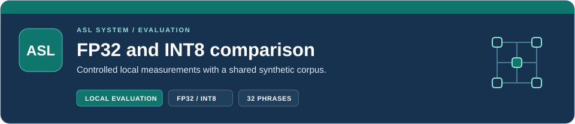

# FP32 and INT8 Comparison



Reproducible local comparison of two already running translator containers using
the same 32 synthetic hotel phrases. The runner creates no accounts, uses no
guest data, and writes nothing to MongoDB. The corpus is independent of training
CSVs and has no human reference translations, so it cannot measure linguistic
accuracy.

[Run](#prerequisites-and-execution) · [Evaluation flow](#evaluation-flow) · [Method](#method) · [Limitations](#interpretation-and-limitations)

## Evaluation flow

The runner measures the two ready containers sequentially, alternating their order for each phrase.

```mermaid
---
config:
  theme: base
  fontFamily: Arial, sans-serif
  htmlLabels: false
  themeVariables:
    fontSize: 15px
    lineColor: "#64748B"
    edgeLabelBackground: "#F1F5F9"
  flowchart:
    curve: linear
    nodeSpacing: 28
    rankSpacing: 36
    padding: 16
---
flowchart LR
  accTitle: Local translator comparison
  accDescr: The runner measures the two ready containers sequentially, alternating their order for each phrase.
  Corpus["32 test phrases"] --> Warmup["Warm up models"]
  Warmup --> Run["Alternate requests"]
  Run --> Metrics["Record resources"]
  Metrics --> Report["Compare outputs"]
  class Warmup,Run service
  class Corpus,Metrics,Report data
  classDef app fill:#16324F,stroke:#4F799D,color:#FFFFFF,stroke-width:1.5px
  classDef service fill:#0F766E,stroke:#0F766E,color:#FFFFFF,stroke-width:1.5px
  classDef data fill:#F1F5F9,stroke:#94A3B8,color:#16324F,stroke-width:1.5px
```



## Prerequisites and execution

Start FP32 and INT8 as described in the [translator guide](../README.md#int8-evaluation).
Both containers must declare `TRANSLATOR_THREADS=2` and return their expected
variant from `/health`. Python and Docker must be available.

From the ASL-System root:

```powershell
python ASL-GlossTranslator/benchmarks/compare.py --docker docker
```

| Option | Default |
| --- | --- |
| `--fp32-url` | `http://127.0.0.1:8002` |
| `--int8-url` | `http://127.0.0.1:8003` |
| `--fp32-container` | `asl-system-asl-gloss-translator-1` |
| `--int8-container` | `asl-system-asl-gloss-translator-int8-1` |
| `--rounds` | `3` |
| `--output` | `.dev-logs/gloss-int8-comparison` |

Override container names if the Compose project name differs. Use `--docker`
with an absolute executable path when Docker is outside `PATH`. External HTTP
targets are rejected. Select a different output directory to retain each run.

## Method

The runner performs three warmups per variant and three repetitions of every
phrase by default. It alternates FP32/INT8 order with only one active request in
total. This is not a concurrent load test. Both models must be ready beforehand;
startup time is outside the measurement.

It produces `comparison.json` and `COMPARACION.md` in the output directory. JSON
retains every response, latency, error, warmup, and memory sample. Summary tables
show mean, p50, and p95 for successful requests; failures remain recorded and
counted.

## Interpretation and limitations

- CPU per request comes from the change in cgroup `usage_usec` across the run,
  including the small resource-query overhead.
- Memory is sampled through `docker stats`; a sampled maximum may miss brief
  peaks and is not a kernel peak measurement.
- Logical image size does not equal incremental disk usage after sharing layers.
  ONNX weight sizes are reported separately.
- Both models share the host; unrelated workloads can influence measurements.
- The translation table shows the first output and stability across repetitions.
  Equality with FP32 means textual equality, not correctness. Different output
  can improve, preserve, or damage meaning.

Review negation, quantities, room numbers, destinations, and urgency before
considering INT8 for deployment. Representative human review and measurements on
the destination hardware are required; the existing comparison does not justify
replacing production FP32 automatically.

## Verify calculations

Without running models or containers:

```powershell
python -m unittest discover -s ASL-GlossTranslator/benchmarks -p test_compare.py -v
```
