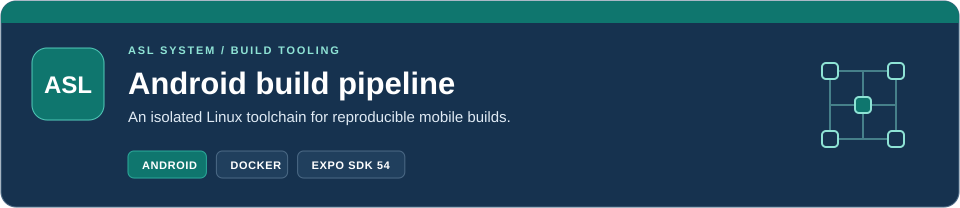

# Android Builds with Docker



Containerized APK tooling for ASL-MobileAPP. The Linux image provides Node.js 22,
Java 17, Android SDK 36, NDK 27.1, and CMake 3.22. The host needs Docker Desktop
with Linux containers; it does not need a local Java installation for this build.

The mobile source is mounted read-only. The runner copies source into a dedicated
Linux volume, excludes private `.env` files, installs dependencies with `npm ci`,
generates Android using Expo, and runs Gradle. Dependency and Gradle caches stay
in Linux volumes. These versions match Expo SDK 54; review the toolchain when
upgrading Expo.

[Prepare](#prepare-the-builder) · [Build pipeline](#build-pipeline) · [Build APK](#build-an-apk) · [Signing](#signing-and-runtime-checks)

## Build pipeline

Source stays read-only on the host while generation, compilation, and verification run in dedicated Linux volumes.

```mermaid
---
config:
  theme: base
  fontFamily: Arial, sans-serif
  htmlLabels: false
  themeVariables:
    fontSize: 15px
    lineColor: "#64748B"
    edgeLabelBackground: "#F1F5F9"
  flowchart:
    curve: linear
    nodeSpacing: 28
    rankSpacing: 36
    padding: 16
---
flowchart LR
  accTitle: Containerized Android build
  accDescr: Source stays read-only on the host while generation, compilation, and verification run in dedicated Linux volumes.
  Source["Read-only source"] --> Workspace["Linux workspace"]
  Workspace --> Expo["Expo prebuild"]
  Expo --> Gradle["Gradle build"]
  Gradle --> Verify["Verify + export"]
  class Workspace,Expo,Gradle service
  class Source,Verify data
  classDef app fill:#16324F,stroke:#4F799D,color:#FFFFFF,stroke-width:1.5px
  classDef service fill:#0F766E,stroke:#0F766E,color:#FFFFFF,stroke-width:1.5px
  classDef data fill:#F1F5F9,stroke:#94A3B8,color:#16324F,stroke-width:1.5px
```



## Prepare the builder

Run from the ASL-System root in PowerShell. Initialize submodules first; the
mobile checkout must contain its tracked `package-lock.json`.

```powershell
docker build -t asl-android-builder .\infra\android
docker volume create asl-android-workspace
docker volume create asl-android-node-modules
docker volume create asl-android-gradle
```

The build context is limited to `infra/android`. The old root `build-apk.ps1`
wrapper is not part of production `main`; use the direct Docker invocation below.

## Build an APK

Select the build variant and source checkout. Production mobile code is on
`master`; use the pinned submodule revision for a reproducible system build.

```powershell
$variant = 'Debug'
$publicBaseUrl = ''
$sourcePath = (Resolve-Path .\ASL-MobileAPP).Path
$outputDirectory = ".dev-logs/android-$($variant.ToLowerInvariant())"
New-Item -ItemType Directory -Force -Path $outputDirectory | Out-Null
$outputPath = (Resolve-Path $outputDirectory).Path

docker run --rm `
  --mount "type=bind,source=$sourcePath,target=/source,readonly" `
  --mount "type=volume,source=asl-android-workspace,target=/workspace" `
  --mount "type=volume,source=asl-android-node-modules,target=/workspace/node_modules" `
  --mount "type=volume,source=asl-android-gradle,target=/root/.gradle" `
  --mount "type=bind,source=$outputPath,target=/output" `
  -e "BUILD_VARIANT=$variant" `
  -e "PUBLIC_BASE_URL=$publicBaseUrl" `
  asl-android-builder
```

For release, change the first two values **before** running the block:

```powershell
$variant = 'Release'
$publicBaseUrl = 'https://your-hotel-gateway.example'
```

Release requires an HTTPS origin without credentials, path, query, or fragment.
The runner embeds matching HTTP/WebSocket gateway destinations. Debug relies on
the app's development network configuration; private host `.env` files are not
copied. Check the configured network defaults before installing a debug build.

Builds produce `.dev-logs/android-debug/app-debug.apk` or
`.dev-logs/android-release/app-release.apk`. Both ARMv7 and ARM64 are included.
The runner verifies package identity, architectures, signing, and that release
is not debuggable before copying the APK. Reusing an output directory replaces
the APK at that path; select a new directory to retain older builds.

## Signing and runtime checks

If present, the source checkout's `android/app/debug.keystore` is reused;
otherwise Expo generates a test key. The release runner requires the certificate
SHA-256 configured in [build.mjs](build.mjs). A different key fails the check.
Provide the expected signing material privately; do not change or bypass the
certificate check merely to make a build pass.

The direct Docker runner does not perform the removed wrapper's live consent-API
preflight. Verify the destination backend's consent contract, authentication,
gateway recognition route, and calls before distributing an APK. Building embeds
configuration but does not deploy a backend.

For a debug APK, Metro and ADB run on the host. The container has no USB access;
install with the host's Android tooling. iOS builds require macOS and are outside
this Linux Android image.

The runner clears its dedicated workspace volume at the start of each build,
preserving `node_modules`. Use these volumes only for this builder and run one
build at a time. Source and unrelated host files remain outside that workspace.
Keep generated APKs, signing material, and local build outputs out of Git.
